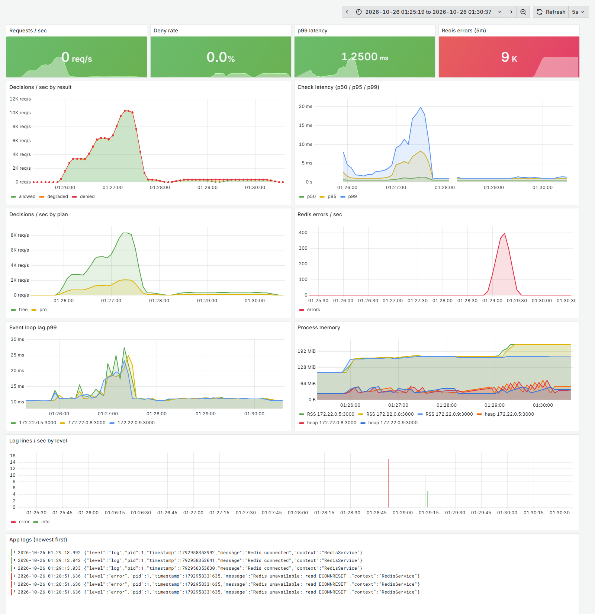
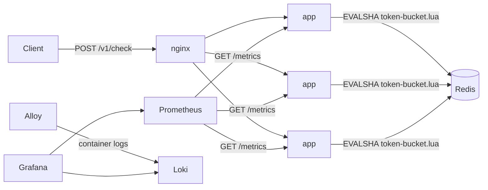
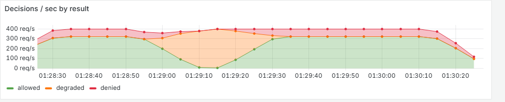
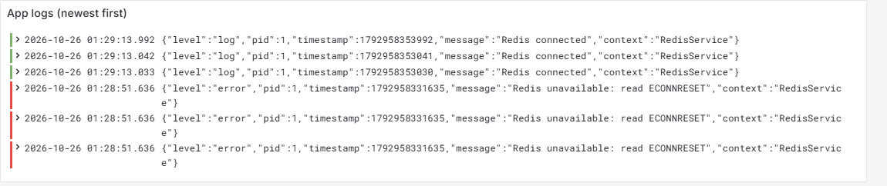
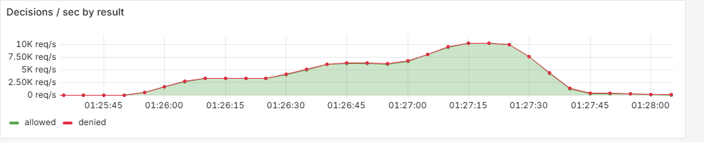
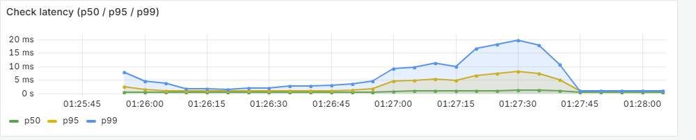

# ratelimiter

A standalone rate-limiting service. Clients call `POST /v1/check` with a key (user, API key or IP) and get back
allowed or denied, tokens remaining and when to retry. Limits are **token buckets stored in Redis and updated
atomically by a Lua script**, so the answer stays correct when many app instances share the same limits.

**Stack:** TypeScript, NestJS, Redis (Lua), Docker Compose, Prometheus, Grafana, Loki, k6.

- **12,000 req/s** on 3 replicas behind nginx (p99 47 ms), **8,000 req/s** on one instance (p99 40 ms), measured on a laptop ([benchmarks](#benchmarks))
- Exactly 100 of 200 concurrent requests allowed against a 100-token bucket, split across two Redis connections
- A parity test runs the Lua script against an in-memory reference implementation; it found a precision bug ([testing](#testing))
- Fail-open or fail-closed when Redis is down, with metrics, dashboards and logs for both



*Grafana during a real run on 3 replicas: a load staircase at 3,000 → 6,000 → 10,000 req/s (01:25–01:28), then Redis
stopped for 20 s at 01:28:51 while traffic continued. The four tiles at the top show the value at the end of the window.*

## Proof

Every claim above links to the evidence behind it. All of it comes from real runs on the machine described in [benchmarks](#benchmarks).

| Claim | Evidence |
|---|---|
| All 31 tests pass (10 unit, 21 against real Redis) | [`docs/proof/tests.txt`](docs/proof/tests.txt), full verbose output |
| Exactly 100 of 200 concurrent requests allowed | `is atomic across app instances` in [`tests.txt`](docs/proof/tests.txt) |
| The parity test caught a real bug | [`docs/proof/parity-bug.txt`](docs/proof/parity-bug.txt), the failing output against the old script |
| 8,000 req/s on 1 instance, 12,000 on 3 replicas | [`docs/proof/benchmark-raw.txt`](docs/proof/benchmark-raw.txt), every k6 run with CPU samples |
| Throughput and latency under load | [load screenshots](#under-load) |
| Fail-open during a Redis outage, logged once per replica | [outage screenshots](#redis-outage) |

## How it works



### Token bucket

Each key has a bucket with a **capacity** (the largest burst) that refills at a fixed **rate** (tokens per second).
Refill is lazy: there is no timer, and each request computes how much the bucket refilled since the last one.

```
tokens = min(capacity, tokens + elapsed * rate)
if tokens >= cost: tokens -= cost  -> allowed
else: retry_after = (cost - tokens) / rate  -> denied
```

Only two values are stored per key (`tokens`, `ts`), so each check is O(1) in time and memory.

### Why a Lua script

Doing read → refill → write from the app is a race: two instances read the same token count and both allow
the request. A Lua script runs **atomically inside Redis**, so there is no race, and it needs one network round trip.

- **Redis `TIME`**, not the app's clock, so clock skew between app servers doesn't matter.
- **`PEXPIRE`** at twice the full-refill time, so idle buckets expire and memory stays bounded.
- **`%.17g`** to store the token count, so a 64-bit float round-trips exactly (see [testing](#testing)).
- Loaded once with `EVALSHA` (ioredis `defineCommand`), not re-sent on every call.

### When Redis is down

The Redis client fails fast: there is no offline queue and commands time out after 100 ms, so a dead Redis can't slow
the API down. `FAIL_OPEN` decides the answer:

| `FAIL_OPEN` | Response | Use when |
|---|---|---|
| `true` (default) | `200`, allowed, `"degraded": true` | Availability matters more than strict limits |
| `false` | `429`, denied, `"degraded": true`, `Retry-After: 1` | Limits protect something expensive |

The outage is logged once when it starts and once when it ends, not once per request. Every failed check is still
counted in `rl_redis_errors_total`.

#### Redis outage

Redis stopped at 01:28:51 and started again at 01:29:12, with about 400 req/s of traffic, on 3 replicas with
`FAIL_OPEN=true`:



Allowed (green) falls to zero and degraded (orange) takes its place: requests keep getting answers while Redis is
down, then return to normal as soon as it is back. Denied (red) is the few abusive keys in the traffic mix. Rates are
averaged over 20 s, so the edges look softer than the real 21-second outage.



Exactly one `Redis unavailable` and one `Redis connected` line **per replica** (3 of each), not one line per
failed request. Prometheus counted 8,700 failed checks during the outage, all 8,700 answered as degraded.

## API

`POST /v1/check`

```json
{ "key": "user-42", "plan": "free", "cost": 1 }
```

| Field | Rules |
|---|---|
| `key` | string, 1–128 characters |
| `plan` | `free` (10 burst, 1/s) or `pro` (100 burst, 20/s); default `free` |
| `cost` | integer 1–1000, at most the plan's capacity; default `1` |

| Status | Body | Headers |
|---|---|---|
| `200` | `{"allowed":true,"remaining":9,"retryAfterMs":0}` | `X-RateLimit-Remaining` |
| `429` | `{"allowed":false,"remaining":0,"retryAfterMs":276}` | `X-RateLimit-Remaining`, `Retry-After` (seconds) |
| `400` | validation errors | |

Buckets are separate per plan: `rl:<plan>:<key>`. `GET /metrics` serves Prometheus metrics.
[`requests.http`](requests.http) has examples you can send from VS Code.

## Running it

Requires Docker.

```bash
docker compose up -d --build        # Redis, app :3000, Prometheus :9090, Grafana :3001, Loki, Alloy
docker compose run --rm k6          # 2 min of mixed traffic so the dashboard has something to show
```

Open **http://localhost:3001** for the "Rate Limiter" dashboard: requests per second, deny rate, p50/p95/p99
latency, Redis errors, event-loop lag, memory, log volume by level and the live app logs.

3 replicas behind nginx, still on port 3000:

```bash
docker compose -f docker-compose.yml -f docker-compose.scale.yml up -d --build
```

Grafana opens with admin rights and no login. That is for local use only; turn it off before exposing it anywhere.

| Env var | Default | |
|---|---|---|
| `REDIS_URL` | `redis://localhost:6379` | |
| `FAIL_OPEN` | `true` | see [When Redis is down](#when-redis-is-down) |
| `PORT` | `3000` | |
| `LOG_LEVEL` | `info` | `debug` logs one line per decision |
| `LOG_FORMAT` | JSON | `pretty` for coloured text |

## Testing

```bash
npm test                              # unit, no Redis needed
docker compose up -d redis
npm run test:e2e                      # against real Redis
```

| Test | What it proves |
|---|---|
| Token bucket (unit, fake clock) | Burst, refill, cap after a long idle, correct retry time |
| LimiterService (unit) | Plan defaults, key namespacing, fail-open/closed, metrics counted |
| **Parity** (e2e) | The Lua script and the in-memory `TokenBucket` give **identical** decisions over 1,000 seeded random steps, for 4 capacity/rate combinations |
| **Atomicity** (e2e) | 200 concurrent requests from 2 Redis connections against a 100-token bucket: exactly 100 allowed |
| API (e2e) | `200`/`429`/`400`, headers, validation, `/metrics` |
| Redis down (e2e) | A real connection failure: fail-open answers `200` degraded, fail-closed answers `429` |

**The parity test found a bug.** The script first saved tokens with Lua's `tostring`, which keeps only 14
significant digits, so `86.99999999999999` was stored as `87`. That granted a token nobody had earned, and the
error carried into later calls. Storing with `%.17g` makes the two implementations agree exactly. The script accepts an
optional `now_ms` argument so the test can drive both implementations from the same simulated clock; production
calls always use Redis `TIME`.

## Benchmarks

k6 holds a fixed request rate for 30 seconds, after a warm-up, and each rate runs twice. Keys are random over 10,000
users (80% free, 20% pro).

**Bar for "sustained":** at least 99% of the target rate achieved, under 1% of requests dropped by k6, p99 under
50 ms, no errors.

**Machine:** Intel Core i5-12500H (12 cores, 16 threads), 16 GB RAM, Windows 11, Docker Desktop, on mains power.
k6, nginx, the app and Redis all ran on this one laptop, so they compete for the same CPU.

**1 instance**

| Target req/s | Achieved | p50 | p95 | p99 | Dropped | App CPU | Redis CPU |
|---|---|---|---|---|---|---|---|
| 4,000 | 4,000 / 3,998 | 0.54 / 0.58 ms | 2.0 / 3.9 ms | 6.1 / 18.1 ms | 0 / 60 | 84% | 19% |
| 6,000 | 6,001 / 6,001 | 0.85 / 0.86 ms | 5.5 / 5.1 ms | 13.6 / 18.6 ms | 0 / 0 | 95% | 25% |
| 7,000 | 6,997 / 6,998 | 1.29 / 1.17 ms | 12.0 / 8.2 ms | 23.6 / 18.7 ms | 89 / 47 | 98% | 28% |
| 8,000 | 7,977 / 7,988 | 3.50 / 3.61 ms | 25.5 / 20.4 ms | 40.3 / 32.5 ms | 670 / 373 | 98% | 31% |

**3 replicas behind nginx**

| Target req/s | Achieved | p50 | p95 | p99 | Dropped | App CPU (each) | nginx CPU | Redis CPU |
|---|---|---|---|---|---|---|---|---|
| 8,000 | 7,990 / 7,991 | 1.15 / 1.14 ms | 4.1 / 3.7 ms | 8.1 / 6.5 ms | 302 / 286 | 83% | 142% | 54% |
| 10,000 | 9,988 / 9,974 | 2.33 / 2.27 ms | 8.7 / 10.8 ms | 16.1 / 28.5 ms | 381 / 772 | 97% | 178% | 60% |
| 12,000 | 11,954 / 11,925 | 4.96 / 6.05 ms | 19.9 / 27.6 ms | 33.5 / 46.7 ms | 1,370 / 2,249 | 102% | 189% | 66% |

The two numbers in a cell are the two runs. CPU is a `docker stats` sample taken halfway through a run; 100% is
one core.

**What the numbers say**

- One instance is **CPU-bound at about 8,000 req/s**: the app reaches about 98% of one core (Node runs JavaScript
  on a single thread) while Redis sits at 31%.
- Three replicas reach **12,000 req/s, 1.5× rather than 3×**, because everything shares one laptop. At that
  rate the replicas use about 3 cores, nginx about 2, Redis 0.7 and k6 several more. On separate machines the
  replicas would not compete with the load generator.
- **Redis is not the bottleneck yet:** about 66% of one core at 12,000 checks/s. Redis runs commands on one
  thread, so a rough extrapolation puts its ceiling for this script near 18,000 checks/s on this machine. Past that,
  the next step is sharding keys across Redis nodes (Redis Cluster), since each key lives in one place.

Reproduce: `docker compose run --rm -e RATE=8000 k6` (add `-f docker-compose.yml -f docker-compose.scale.yml`
before `run` for the replicas). Raw output of every run: [`docs/proof/benchmark-raw.txt`](docs/proof/benchmark-raw.txt).

### Under load

A separate staircase run on 3 replicas: 30 s each at 3,000, 6,000 and 10,000 req/s, on top of about 400 req/s of
mixed demo traffic. k6 measured 2,997, 5,997 and 9,923 req/s achieved, with no failed requests.





This graph is the **server-side** time to decide (`rl_check_duration_seconds`: validation done, Lua call to Redis
and back). k6's numbers in the tables are end-to-end, including nginx, Docker networking and queueing in the load
generator, which is why they are higher.

## Project layout

```
src/
  limiter/core/        in-memory TokenBucket + clocks (the reference implementation)
  limiter/lua/         token-bucket.lua
  limiter/             controller, service (plans, fail-open, metrics), DTO
  redis/               ioredis client, script registration, connection-state logs
  metrics/             prom-client metrics + GET /metrics
  config/plans.ts      plan -> capacity, refill rate
test/                  unit (*.spec.ts) and real-Redis (*.e2e-spec.ts) tests
load/check.k6.js       demo traffic and benchmark mode
docker/                Prometheus, Grafana (provisioned dashboard), Alloy, nginx config
```
